<div align="center">
  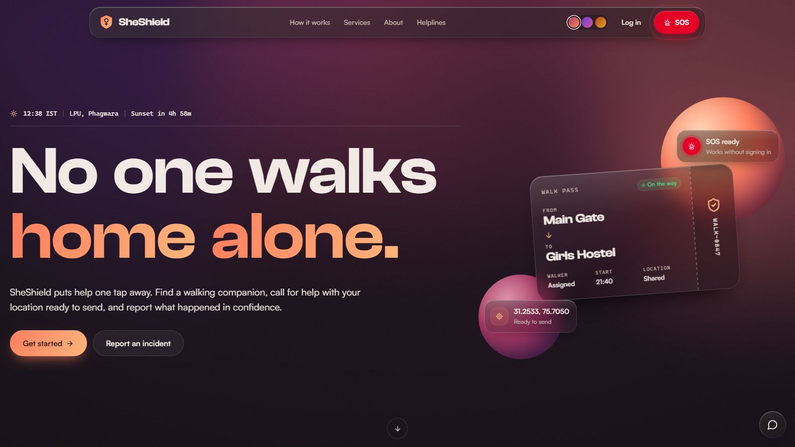
  <br><br>
  <h1>🛡️ SheShield</h1>
  <h3>No one walks home alone.</h3>
  <p><em>A campus safety platform for women at Lovely Professional University: one-tap SOS, walking companions, confidential reporting and a live satellite safety map.</em></p>
  <a href="https://github.com/Ankit-Basu/SheShield/actions/workflows/main.yml"></a>
  <br>
  <a href="#-key-features">Features</a> •
  <a href="#-screenshots">Screenshots</a> •
  <a href="#-tech-stack">Tech Stack</a> •
  <a href="#-cicd--devops-pipeline">CI/CD & DevOps</a> •
  <a href="#-installation">Installation</a> •
  <a href="#-project-structure">Structure</a> •
  <a href="#-performance">Performance</a> •
  <a href="#-security">Security</a> •
  <a href="#-roadmap">Roadmap</a>
</div>

---

## 🌟 About SheShield

**SheShield** is a women's safety platform built around one idea: when something feels wrong, you should not have to work out who to call, where you are, or how to explain it.

It pairs a glassmorphic interface with a PHP and MySQL backend. Every library, font and icon is served locally, and the only runtime network calls are map tiles and, when needed, Firebase sign-in.

---

## ✨ Key Features

### 🆘 Emergency SOS
- Opens instantly from every page, **with no sign-in**
- **Call 112, 1091 or 100 in one tap**, without waiting for GPS
- Finds your exact location and logs an alert
- Send your location by WhatsApp or SMS, copy it, or open it in Google Maps

> SOS does not message anyone automatically. You choose who receives your location.

### 🗺️ LPU Safety Map
- Satellite and street views of the real campus, with its OpenStreetMap boundary
- Reports grouped into one count per place. Other people's descriptions stay private
- Mark your own open reports as resolved

### 👣 Walk With Us
- Requests are saved and matched with a **verified** walker on duty at that time
- See and cancel your walks, with a confirmation email for each request
- Volunteers register with ID details and are only matched after an admin verifies them

### 📝 Incident Reporting
- File with your name or **fully anonymously**, unlinked from your account
- Attach photos or PDFs as evidence, and get a report ID once it is saved
- Guided complaint templates for harassment, stalking, cybercrime and POSH

### 🛡️ Safe Spaces
- See places marked as safe, and draw your own as an area, circle or point
- Choose how long a safe zone stays active

### 📊 Dashboard and Analytics
- Quick actions, live campus clock, and your reports by status, type and time
- Three themes from [tweakcn](https://tweakcn.com): Sunset Horizon, Cosmic Night and Solar Dusk

### 🔑 Admin
- Update report status and view evidence
- Verify walkers and assign them to walk requests

---

## 💻 Tech Stack

<div align="center">
  <table>
    <tr>
      <td align="center"><strong>Frontend</strong></td>
      <td align="center"><strong>Backend</strong></td>
      <td align="center"><strong>Libraries & APIs</strong></td>
      <td align="center"><strong>DevOps & Infrastructure</strong></td>
    </tr>
    <tr>
      <td>
        • HTML5 / CSS3<br>
        • Vanilla JS (ES6+)<br>
        • Glass design system (tweakcn tokens, shadcn/ui anatomy)<br>
        • React Bits effects, ported to plain JS<br>
        • Custom Fonts (Clash Display, Satoshi)<br>
      </td>
      <td>
        • PHP 8.2+<br>
        • MySQL / MySQLi<br>
        • JSON API endpoints<br>
        • Session-based Auth<br>
      </td>
      <td>
        • GSAP 3.13 + ScrollTrigger<br>
        • Lenis Smooth Scroll<br>
        • Leaflet + Leaflet.draw<br>
        • Esri imagery + OpenStreetMap data<br>
        • Firebase Auth (Google sign-in)<br>
        • PHPMailer (SMTP)<br>
        • Geolocation API<br>
        • Lucide icons<br>
      </td>
      <td>
        • Docker & Docker Compose<br>
        • Jenkins (CI/CD Pipeline)<br>
        • GitHub Actions<br>
        • SonarQube (Code Quality)<br>
        • Aqua Trivy (Security Scan)<br>
        • Sonatype Nexus (Artifact Registry)<br>
        • Prometheus & Grafana (Monitoring)<br>
        • Kubernetes & Helm (Orchestration)<br>
        • Terraform & AWS (Cloud IaC)<br>
        • Ansible (Config Management)<br>
        • Husky & Commitlint (Git Hooks)<br>
      </td>
    </tr>
  </table>
</div>

---

## 🔄 CI/CD & DevOps Pipeline

SheShield implements a **production-grade, fully automated DevOps pipeline** using an end-to-end Infrastructure-as-Code (IaC) approach. Every code push triggers a multi-stage pipeline that builds, scans, analyzes, pushes, and deploys the application automatically.

### Pipeline Architecture

```
  ┌──────────┐    ┌──────────┐    ┌──────────────┐    ┌───────────┐    ┌──────────┐    ┌──────────┐    ┌──────────┐
  │ Checkout  │───▶│  Build   │───▶│ Security Scan│───▶│ SonarQube │───▶│  Push to │───▶│ Deploy to│───▶│  Monitor │
  │   SCM     │    │  Docker  │    │  (Trivy)     │    │ Analysis  │    │  Nexus   │    │   K8s    │    │ (Grafana)│
  └──────────┘    └──────────┘    └──────────────┘    └───────────┘    └──────────┘    └──────────┘    └──────────┘
       │                │                │                  │               │               │               │
    GitHub          Dockerfile       CVE Scanning      Code Quality    Docker Registry   Kubernetes    Prometheus
    Actions         Multi-stage      HIGH/CRITICAL      16k+ LOC       Sonatype Nexus    3 Replicas    + Grafana
```

### 🏗️ Jenkins Pipeline (7 Stages)

The Jenkins pipeline (`infrastructure/jenkins/Jenkinsfile`) executes the following stages on every build:

| Stage | Tool | Description |
|-------|------|-------------|
| **1. Checkout SCM** | Git | Pulls latest code from GitHub repository |
| **2. Build Docker Image** | Docker | Builds the PHP 8.2-Apache image with all dependencies |
| **3. Security Scan** | Aqua Trivy | Scans Docker image for HIGH/CRITICAL CVEs |
| **4. SonarQube Analysis** | SonarQube | Static code analysis — bugs, vulnerabilities, code smells |
| **5. Push to Nexus** | Sonatype Nexus | Pushes versioned Docker image to private artifact registry |
| **6. Deploy to K8s** | Kubernetes | Rolling deployment with 3 replicas + MySQL service |
| **7. Post Actions** | Jenkins | Cleanup workspace, success/failure notifications |

<div align="center">
  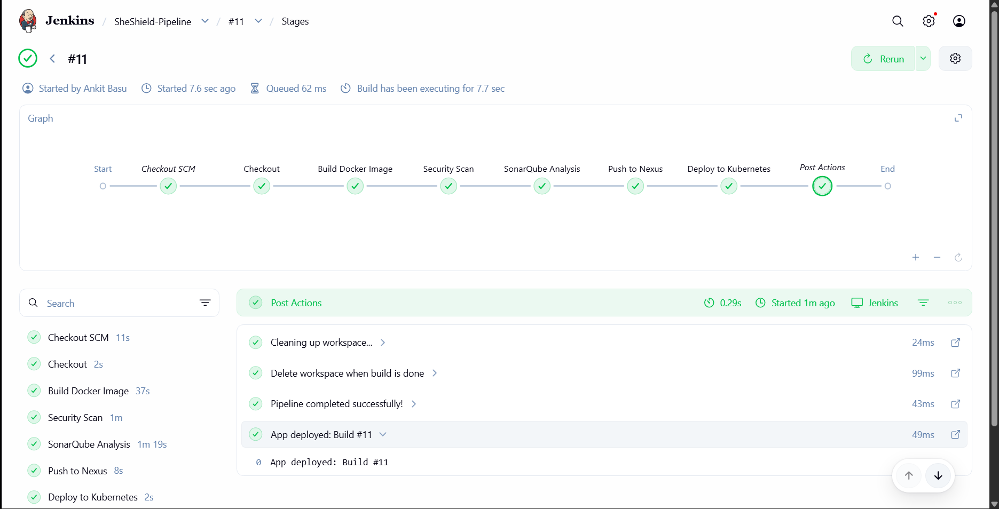
  <br><em>Jenkins Pipeline — Build #11 with all 7 stages passing ✅</em>
</div>

---

### 🐙 GitHub Actions CI/CD

A parallel GitHub Actions workflow (`.github/workflows/main.yml`) runs on every push to `master`:

- **PHP 8.2 Setup** with pdo_mysql, mysqli, gd, zip extensions
- **Composer & NPM** dependency installation
- **Aqua Trivy** filesystem security scan
- **Docker image build** validation
- **Deployment gate** for production releases

---

### 🔍 SonarQube — Code Quality & Security Analysis

SonarQube performs deep static analysis across **16,000+ lines of code** in 9 languages (PHP, JavaScript, CSS, HTML, YAML, Docker, Terraform, XML, JSON):

| Metric | Value |
|--------|-------|
| **Lines of Code** | 16,470 |
| **Security Issues** | 23 |
| **Reliability (Bugs)** | 229 |
| **Maintainability (Code Smells)** | 814 |
| **Duplications** | 11.0% |
| **Quality Gate** | ✅ Passed |

<div align="center">
  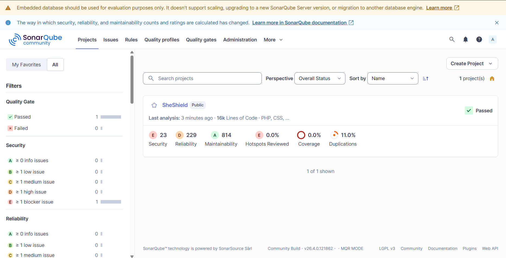
  <br><em>SonarQube Dashboard — Full code quality analysis with Quality Gate passed</em>
</div>

---

### 📦 Sonatype Nexus — Docker Artifact Registry

All Docker images are versioned and stored in a private **Sonatype Nexus** repository, enabling:

- **Immutable artifact versioning** — every Jenkins build pushes `sheshield:<build_number>` + `sheshield:latest`
- **Docker V2 Registry** protocol on port `8082`
- **Manifest and layer deduplication** for storage efficiency
- **Rollback capability** — pull any previous version instantly

<div align="center">
  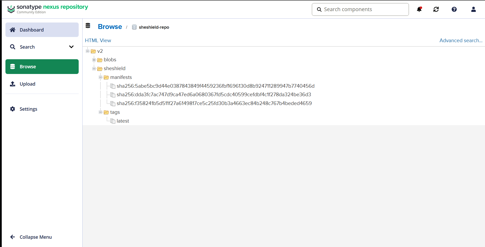
  <br><em>Sonatype Nexus — sheshield Docker image with manifests, blobs & versioned tags</em>
</div>

---

### 📊 Grafana & Prometheus — Infrastructure Monitoring

A fully automated monitoring stack deployed via Docker Compose with **Infrastructure-as-Code** provisioning:

- **Prometheus** — Metrics scraping (self-metrics + Docker Engine)
- **Grafana** — 16-panel auto-provisioned dashboard with:
  - 🟢 Service health status indicators
  - 📈 CPU, Memory, and Heap utilization graphs
  - 🌐 HTTP request rate by handler (stacked %)
  - 🧵 Goroutine tracking and GC cycle analysis
  - 📦 TSDB storage metrics (chunks, samples/sec)
  - 📋 File descriptor monitoring

<div align="center">
  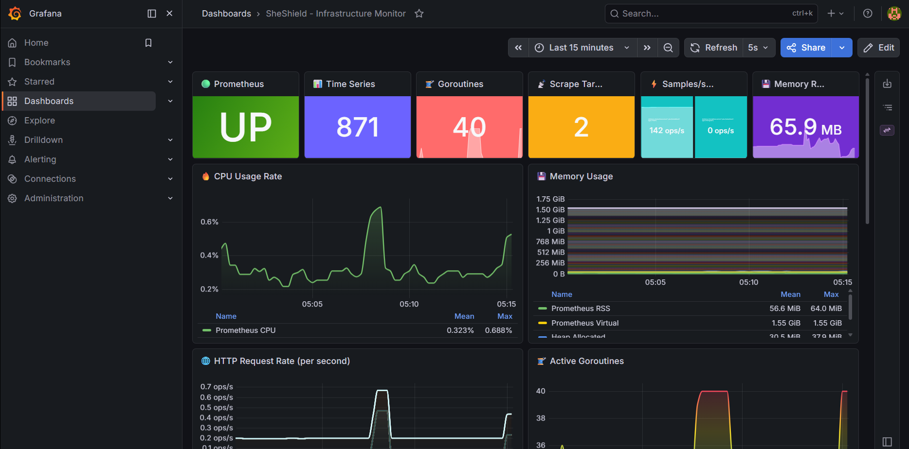
  <br><em>Grafana Infrastructure Monitor — Real-time observability with 16 auto-provisioned panels</em>
</div>

---

### 🐳 Docker & Kubernetes

| Component | Configuration |
|-----------|--------------|
| **Dockerfile** | Multi-stage PHP 8.2-Apache build with Composer, GD, PDO, and security hardening |
| **Docker Compose** | Unified stack: Prometheus + Grafana + SonarQube + Nexus (one command start/stop) |
| **Kubernetes** | 3-replica Deployment + LoadBalancer Service + MySQL + HPA in `sheshield` namespace |
| **Nexus Registry** | Docker-hosted repo at `127.0.0.1:8082` with HTTP connector |

```bash
# Start ALL DevOps tools with one command
docker compose -f infrastructure/docker-compose.yml up -d

# Stop everything
docker compose -f infrastructure/docker-compose.yml down
```

---

### ⎈ Helm Chart

Kubernetes deployments are packaged as a **Helm chart** for environment-specific configuration:

```bash
# Preview what Helm will deploy
helm template sheshield infrastructure/helm/sheshield

# Install to cluster
helm install sheshield infrastructure/helm/sheshield --namespace sheshield --create-namespace

# Override values for production
helm install sheshield infrastructure/helm/sheshield -f production-values.yaml
```

Configurable via `values.yaml`: replica count, resource limits, autoscaling thresholds, MySQL credentials, and image tags.

---

### 🌍 Terraform & AWS (Infrastructure-as-Code)

Terraform provisions the complete AWS infrastructure with **100% Free Tier** resources:

| Resource | Type | Monthly Cost |
|----------|------|-------------|
| **EC2** | t2.micro (1 vCPU, 1GB RAM) | $0.00 (Free Tier) |
| **RDS MySQL** | db.t3.micro | $0.00 (Free Tier) |
| **S3** | 5GB storage | $0.00 (Free Tier) |
| **ECR** | Private Docker registry | $0.00 (500MB free) |
| **VPC** | VPC + IGW + Subnets | $0.00 (Always free) |
| | **Total** | **$0.00/mo** |

```bash
cd infrastructure/terraform
terraform init
terraform plan        # Preview what will be created (no cost)
terraform apply       # Deploy to AWS
```

---

### 🔧 Ansible (Configuration Management)

Ansible automates EC2 server provisioning — installs PHP, Apache, Docker, deploys the app, and starts the monitoring stack:

```bash
# Run playbook against your EC2 server
cd infrastructure/ansible
ansible-playbook -i inventory.ini playbook.yml
```

---

### 🐶 Husky & Commitlint (Git Hooks)

Every commit is automatically validated against [Conventional Commits](https://www.conventionalcommits.org/) format:

```bash
# ✅ Valid commits
git commit -m "feat(auth): add password reset flow"
git commit -m "fix: resolve SOS button race condition"
git commit -m "docs: update README with DevOps pipeline"

# ❌ Rejected commits
git commit -m "fixed stuff"          # No type prefix
git commit -m "FEAT: ADD FEATURE"    # Uppercase not allowed
```

---

## 📸 Screenshots

### Landing Page
<div align="center">
  
  <br><em>A live campus clock and frosted glass over solid spheres</em>
</div>

### How It Works
A route across the real campus draws itself as you scroll.

<div align="center">
  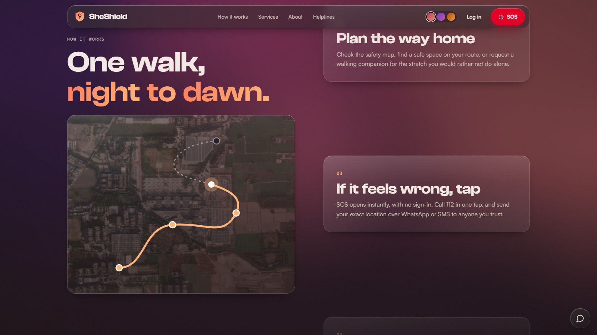
  
</div>

### SOS Demo
Scrolling drives a phone through what one tap actually does.

<div align="center">
  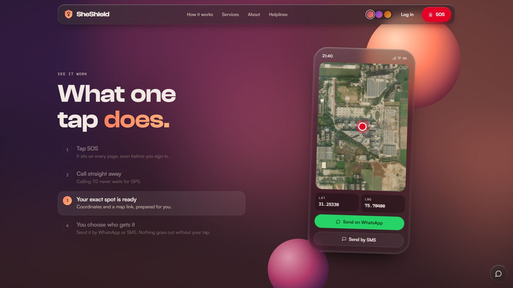
  
</div>

### Services
<div align="center">
  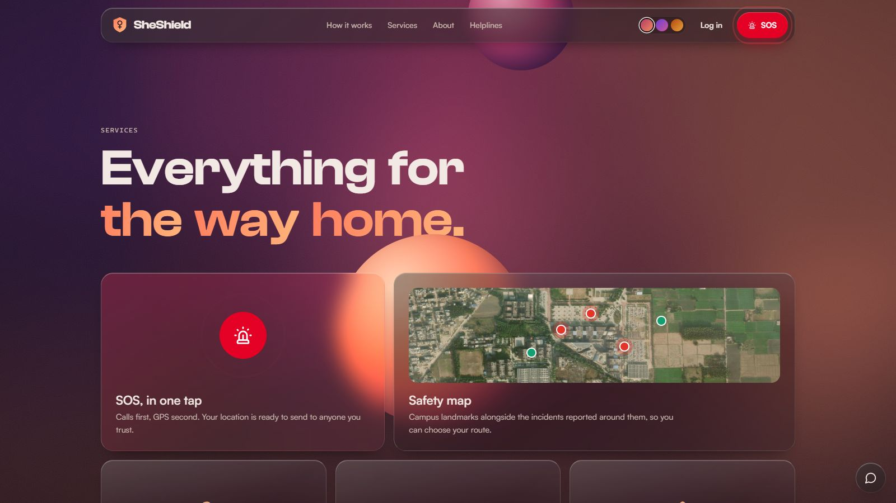
  
</div>

### Emergency SOS
Call buttons work immediately, and your location is ready to send.

<div align="center">
  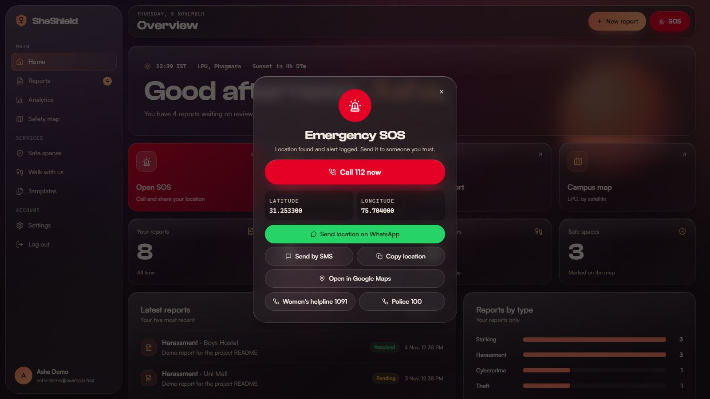
  
</div>

### Dashboard
<div align="center">
  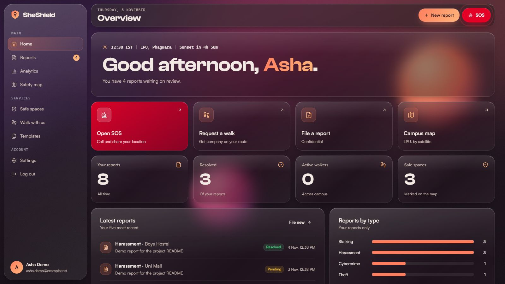
  
</div>

### Campus Safety Map
<div align="center">
  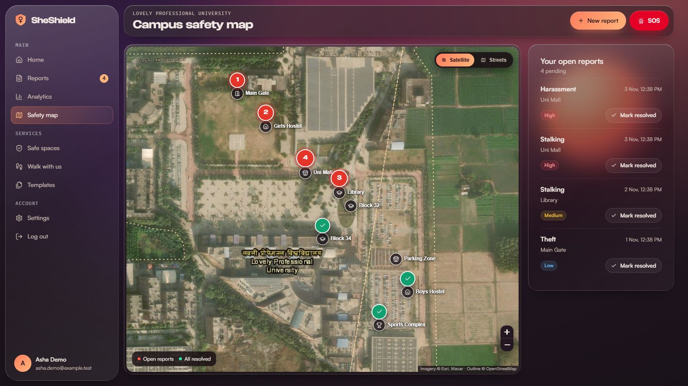
  
</div>

### Safe Spaces
<div align="center">
  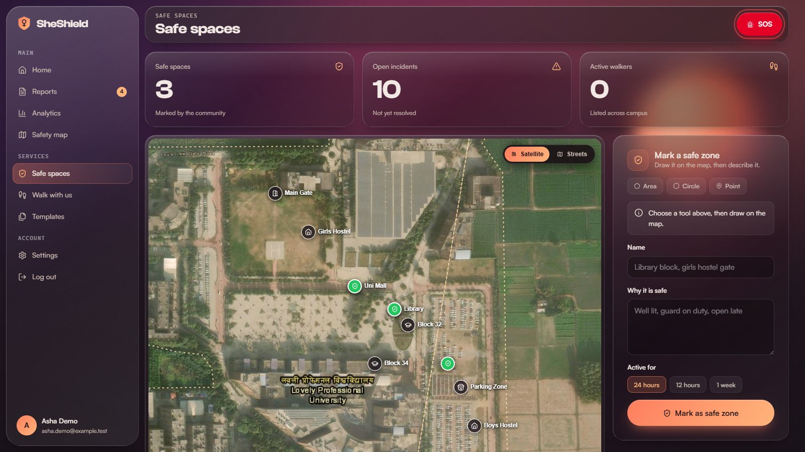
  
</div>

### Walk With Us
<div align="center">
  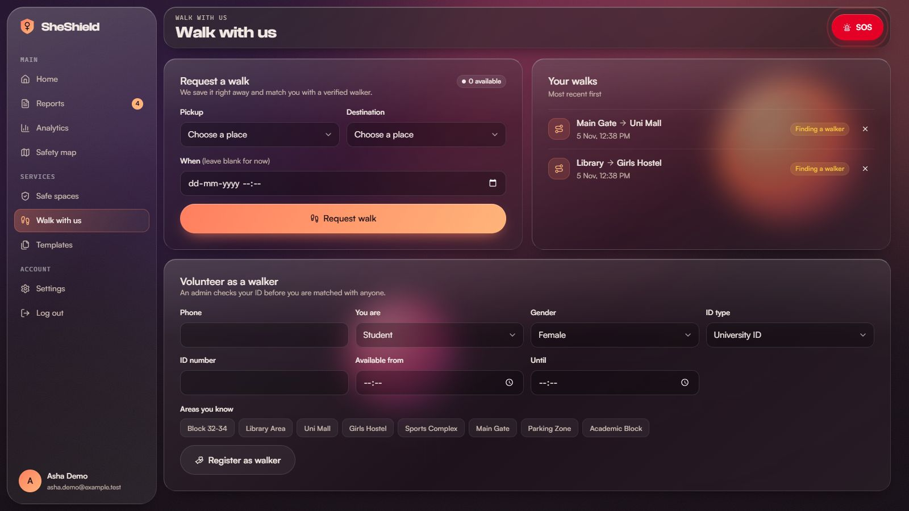
  
</div>

### Report an Incident
<div align="center">
  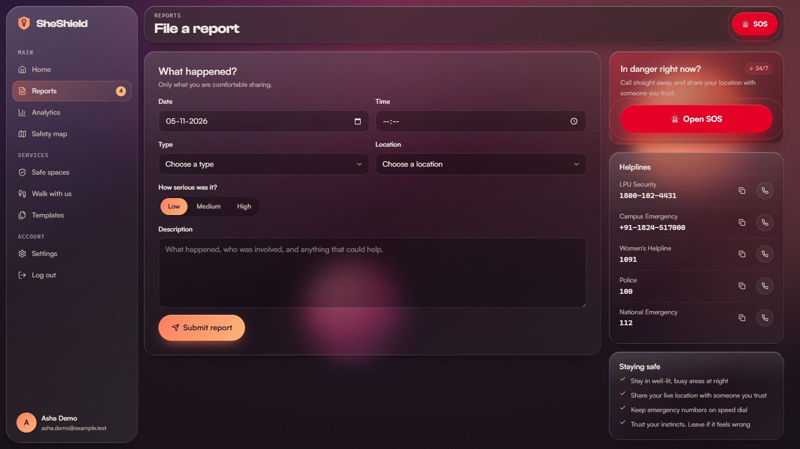
  
</div>

### Analytics
<div align="center">
  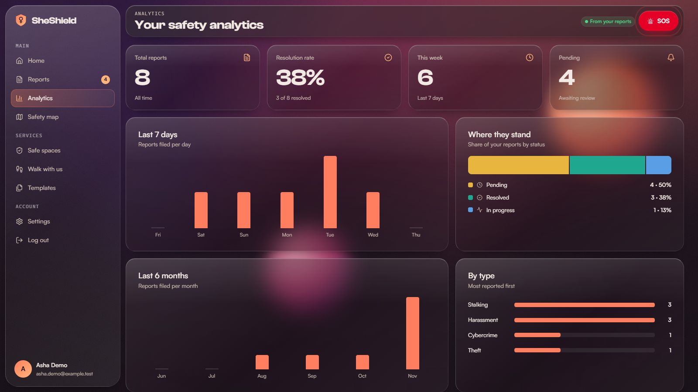
  
</div>

### Complaint Templates
<div align="center">
  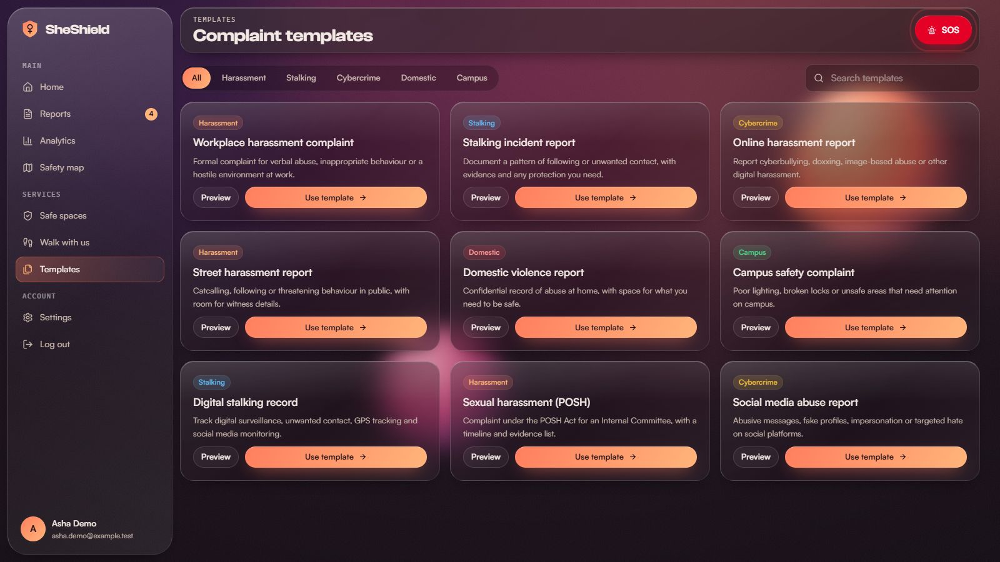
  
</div>

### Sign In
<div align="center">
  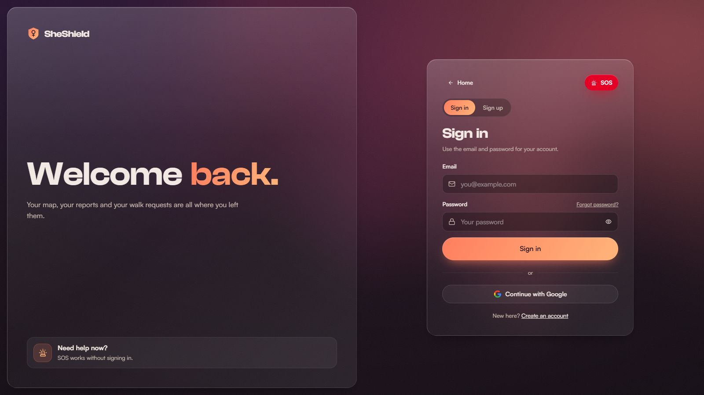
  
</div>

### On Mobile
Every page adapts to a phone, with SOS always within reach in the bottom dock.

<div align="center">
  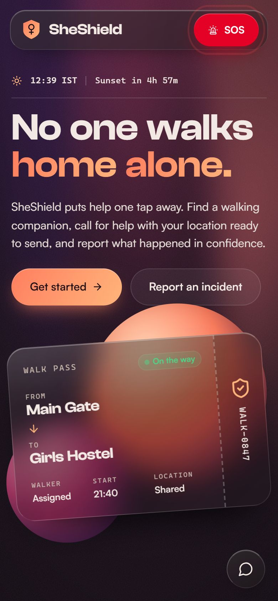
  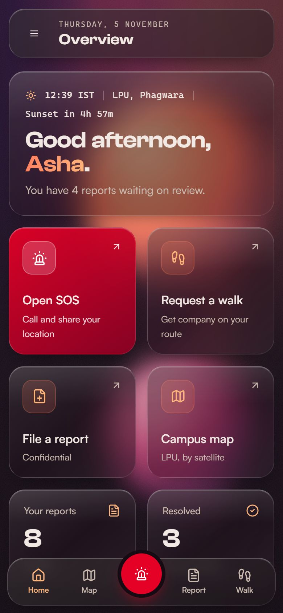
  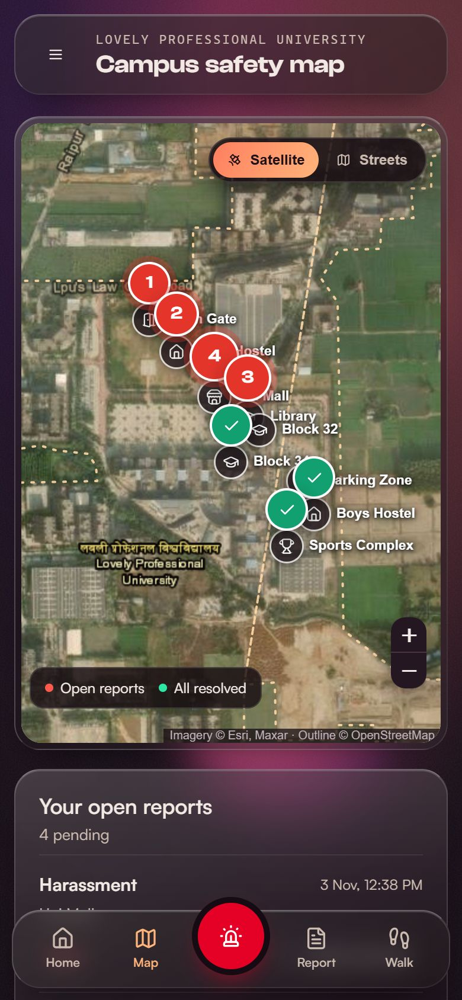
</div>

---

## 🚀 Installation

### Prerequisites
- **PHP** 8.2 or higher with mysqli, pdo_mysql and gd
- **MySQL** 5.7+ or MariaDB
- **XAMPP**, WAMP, MAMP or any Apache and MySQL stack
- A Gmail account with an App Password, for walk confirmation emails

### Quick Setup

```bash
# 1. Clone into your web server's document root (XAMPP: htdocs/)
git clone https://github.com/Ankit-Basu/SheShield.git sheshield
cd sheshield

# 2. Configure email (optional: everything except confirmation emails works without it)
cp app/config/email_config.example.php app/config/email_config.php

# 3. Start Apache and MySQL, then open the site
# http://localhost/sheshield/
```

The database and tables are created automatically on the first request.

### Run with Docker

From the repository root, this starts the app, MySQL and phpMyAdmin:

```bash
docker compose -f infrastructure/docker/docker-compose.yml up -d --build
```

The site is at http://localhost:8080, and phpMyAdmin at http://localhost:8081. If port 8080 is taken, set `APP_PORT` first, for example `APP_PORT=8095`.

The app reads `DB_HOST`, `DB_NAME`, `DB_USER`, `DB_PASS` and `DB_PORT` from the environment, which Docker Compose, Kubernetes and Helm all set. Without them it falls back to the XAMPP defaults. Set `DB_SSL=true` for hosted MySQL that requires encryption. Email config is never baked into the image: set `BREVO_API_KEY` or the `SMTP_*` variables (see [the deploy guide](docs/DEPLOY_RENDER_VERCEL.md#environment-variables-the-app-reads)), or mount `app/config/email_config.php`.

### Deploy for free (Render + Vercel)

`render.yaml` and `vercel.json` deploy the PHP app on Render's free plan, a free Aiven MySQL database, and the public pages on Vercel. Follow the step-by-step guide: **[docs/DEPLOY_RENDER_VERCEL.md](docs/DEPLOY_RENDER_VERCEL.md)**.

To make someone an admin, add their user id to the `admins` table, then have them sign in again:

```sql
INSERT INTO admins (user_id) VALUES (1);
```

### More guides
- [Free deploy: Render + Vercel](docs/DEPLOY_RENDER_VERCEL.md)
- [Full DevOps stack setup](docs/SETUP.md)
- [Email setup](docs/EMAIL_SETUP.md)
- [Firebase and Google sign-in](docs/FIREBASE_SETUP.md)
- [AWS deployment](docs/AWS_DEPLOYMENT_GUIDE.md)
- [DevOps presentation guide](docs/DEVOPS_PRESENTATION_GUIDE.md)

### Rebuilding front-end libraries

Local copies live in `public/lib/`. After upgrading GSAP, Lenis or Leaflet, or adding an icon:

```bash
npm install
npm run build:vendor
```

---

## 📋 Project Structure

```
SheShield/
├── index.php              # Redirects the site root to the landing page
├── pro/                   # Public pages: landing, login, signup, report
├── views/pages/           # Signed-in dashboard pages and shared layout
├── admin/                 # Admin pages: reports, walkers, walk requests
├── api/                   # All JSON endpoints
│   ├── auth/              #   login, signup, logout, session status, Firebase
│   ├── emergency/         #   SOS alert logging
│   ├── incidents/         #   create, resolve, update status
│   ├── safespaces/        #   list and save safe zones
│   ├── user/              #   profile, password, photo
│   ├── walks/             #   requests, volunteers, confirmation email, admin
│   └── public_stats.php   #   anonymous counts for the landing page
├── app/
│   ├── config/            # Database config and email config template
│   ├── helpers/           # Profile image handling
│   ├── lib/PHPMailer/     # Email library
│   ├── middleware/        # Sessions
│   └── models/            # Incident and User models
├── database/              # Connection, automatic schema setup, SQL migrations
├── public/                # Everything the browser downloads
│   ├── css/               #   Glass design system and landing styles
│   ├── js/                #   Core motion and SOS, landing, map, auth
│   ├── lib/               #   Local GSAP, Lenis and Leaflet
│   ├── fonts/  images/  assets/  icons.svg
├── docs/                  # Setup, deployment and DevOps guides
├── infrastructure/        # Docker, Jenkins, Kubernetes, Helm, Terraform, Ansible, monitoring
├── screenshots/           # Images used in this README
└── scripts/               # Rebuilds public/lib and the icon sprite
```

---

## ⚡ Performance

Measured with real mouse-wheel scrolling in Chrome on Intel Iris Xe integrated graphics:

| Measure | Result |
|---------|--------|
| Landing page scrolling | 60 frames per second on screen, none slower than 50 ms |
| Landing page on a 4x slower CPU | About 60 frames per second on screen, in lite mode |
| Dashboard page scrolling | 55 to 60 frames per second, no long tasks |
| Dashboard page load | 65 to 336 ms |
| Map page load, including satellite imagery | About 1.7 s |
| Server response | Dashboard about 31 ms, API about 27 ms |
| Landing page download | 15 requests, about 740 KB, nothing from third parties |

Slower devices lower the aurora frame rate and turn off blur automatically.

---

## 🔒 Security

| Layer | Implementation |
|-------|---------------|
| **Authentication** | Session-based auth with `password_hash()` / `password_verify()` |
| **Authorization** | Dashboard pages require sign-in, and admin actions require an admin account |
| **Ownership** | Reports can only be resolved by their owner or an admin |
| **Database** | Prepared statements across the live endpoints |
| **Privacy** | Anonymous reports are unlinked from accounts, and the shared map shows counts only |
| **Email** | Sent only to the signed-in user, over TLS via PHPMailer |
| **Config** | Credentials live in `.gitignore`-protected config files |
| **Container** | Aqua Trivy CVE scanning on every Docker build |
| **Code Quality** | SonarQube static analysis with Quality Gate enforcement |

---

## 🗺️ Roadmap

- [x] Glass design system with GSAP scroll motion
- [x] One-tap SOS with location sharing
- [x] Satellite campus map with grouped reports
- [x] Walk With Us with verified walker matching
- [x] Anonymous reporting with evidence upload
- [x] Admin tools for reports and walkers
- [x] Docker, Jenkins, GitHub Actions, SonarQube, Trivy and Nexus
- [x] Kubernetes, Helm, Terraform, Ansible, Prometheus and Grafana
- [x] Husky and Commitlint git hooks
- [ ] Automatic SOS alerts to emergency contacts
- [ ] Verified building positions on the campus map
- [ ] Native mobile app
- [ ] AI-powered assistant
- [ ] Multi-language support

---

## 👥 Team

Built by students passionate about making campuses safer for women through modern web development and DevOps practices.

## 📄 License

This project is licensed under the **MIT License**.

## 🤝 Contributing

We welcome contributions! Here's how:

1. Fork the repository
2. Create a feature branch (`git checkout -b feature/amazing-feature`)
3. Commit your changes (`git commit -m 'Add amazing feature'`)
4. Push to the branch (`git push origin feature/amazing-feature`)
5. Open a Pull Request

---

<div align="center">
  <strong>🛡️ SheShield — Safety. Support. Empowerment.</strong>
  <br>
  <sub>Built with ❤️ for every woman, every night, every journey.</sub>
</div>
