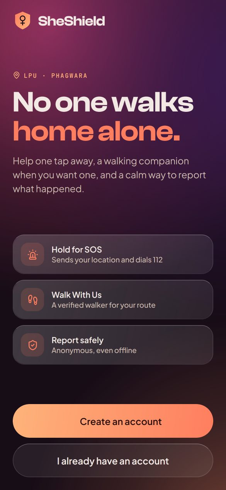
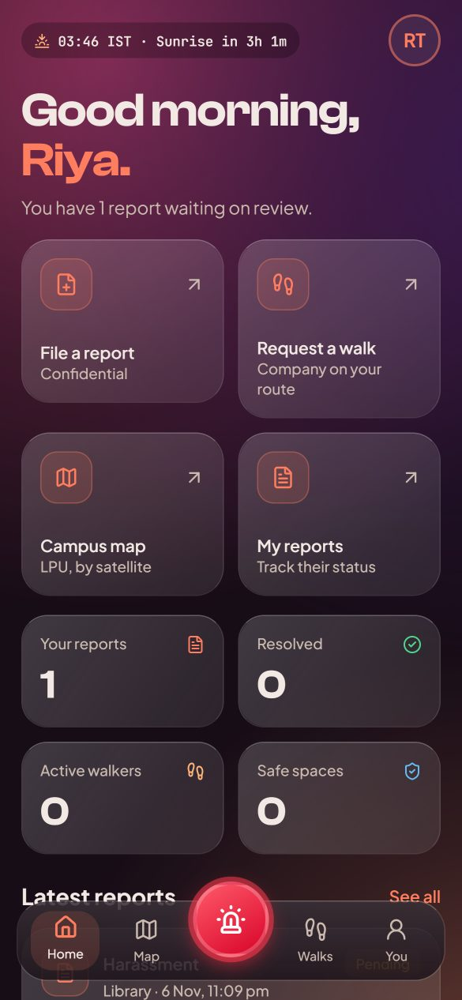
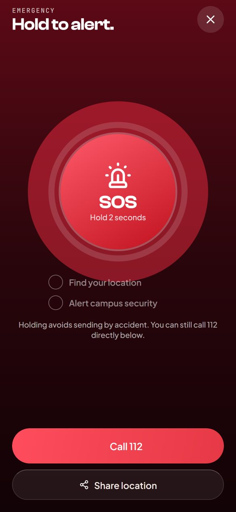
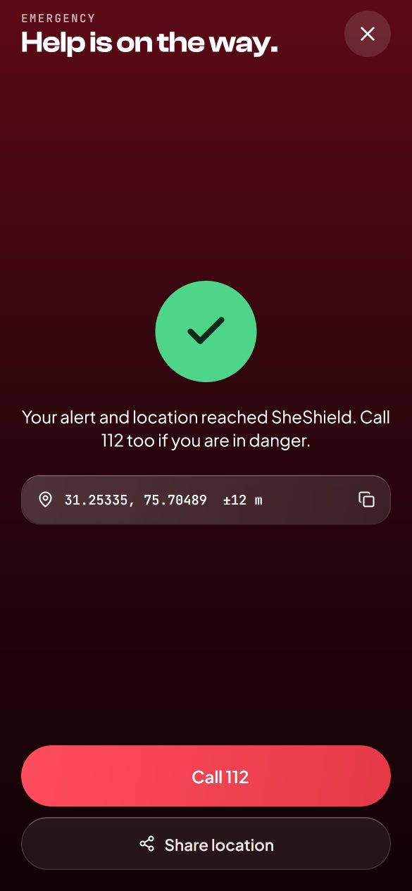
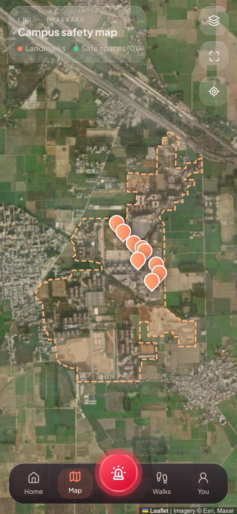
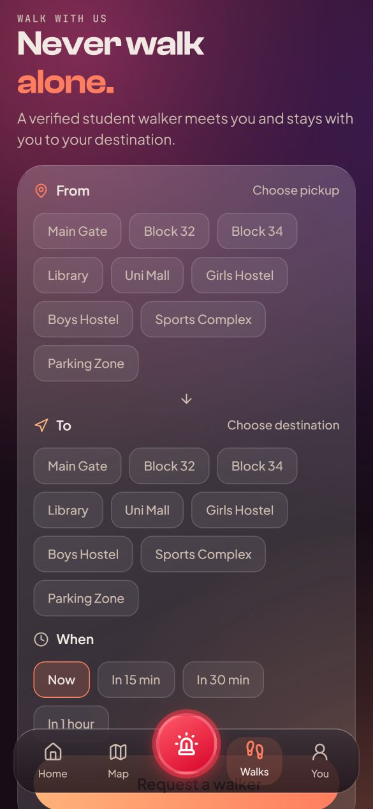
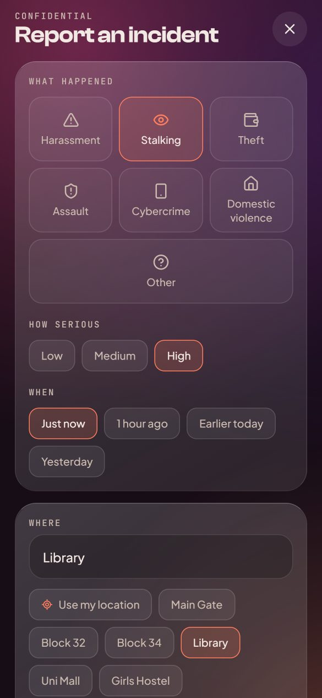
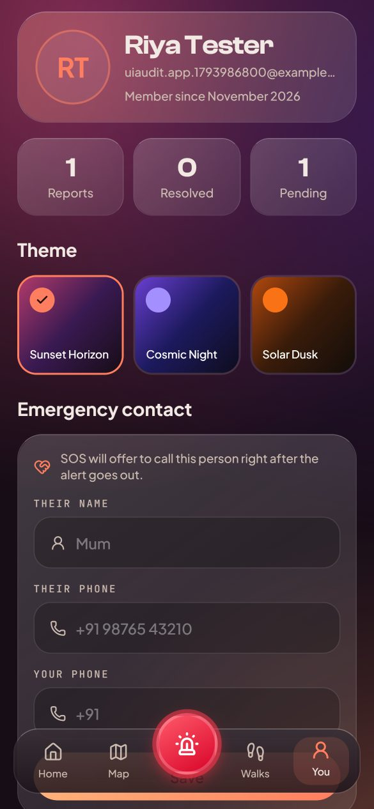

<div align="center">

# SheShield Mobile

**Campus safety for women at LPU, in your pocket.**
Hold-to-send SOS with live location, a walking companion on request, confidential incident reports that work offline, and a satellite map of campus.

React Native · Expo SDK 58 · TypeScript · Expo Router · TanStack Query · Zustand · Reanimated 4

</div>

<p align="center">
  
  
  
  
</p>
<p align="center">
  
  
  
  
</p>

## What it does

| Feature | How it works |
|---|---|
| **Hold-to-send SOS** | Always one tap away in the middle of the tab bar. Hold for 1.6 s while a ring fills with rising haptic ticks, so a pocket tap never sends an alert. Uses the last known location instantly, then a fresh GPS fix within 8 s, sends it to the backend, and offers Call 112, call or text your emergency contact, or share a Google Maps link. If sending fails, every fallback still works. |
| **Walk With Us** | Choose pickup, destination and time from campus landmarks. The server assigns a verified walker who is on duty. Walks update optimistically: cancel shows at once and rolls back if the server refuses. |
| **Incident reports** | Type, severity, time, landmark or GPS location, up to 3 photos from the camera or gallery, and a fully anonymous option. **Works offline:** with no signal the report is saved on the phone and sent automatically when the connection returns. |
| **Campus map** | Esri satellite or street tiles with the official OpenStreetMap campus outline, landmarks and safe spaces. Runs Leaflet in a WebView, so the installed app needs no map API key. Tap a landmark to walk from it or report there. |
| **Dashboard** | Live IST clock with next sunrise or sunset at LPU, your report numbers, active walk, latest reports and one-tap helplines. Pull to refresh everywhere. |
| **Never an empty screen** | Render's free server sleeps when idle and takes up to a minute to wake. Every screen loads the last data saved on the phone (or realistic sample data on a first run) if the server doesn't answer within 10 s, shows a "waking up" banner, and retries every 15 s until live data arrives. |
| **Themes** | The website's three tweakcn themes (Sunset Horizon, Cosmic Night, Solar Dusk), saved between launches. |
| **Secure sign-in** | Email and password exchange for a random token stored in the Android Keystore / iOS Keychain (`expo-secure-store`). The server keeps only a SHA-256 hash and revokes it on sign-out. |

## Tech stack

- **Expo SDK 58 / React Native 0.88 / React 19** with the New Architecture and the React Compiler
- **Expo Router**: file-based routes, protected route groups, modal and full-screen modal screens
- **TanStack Query**: server state, caching, pull-to-refresh, optimistic updates
- **Zustand**: auth, theme, toast and offline-queue stores (theme persisted with AsyncStorage)
- **Reanimated 4**: UI-thread animations (aurora, SOS ring, tab bar, press feedback, list entry)
- **react-native-svg** (gradients, SOS progress ring), **expo-linear-gradient**, **expo-blur** (iOS tab bar)
- **expo-location, expo-image-picker, expo-haptics, expo-secure-store, expo-clipboard**, NetInfo, WebView
- **Lucide** icons, **Clash Display** + **Plus Jakarta Sans** + **JetBrains Mono** fonts
- Backend: the SheShield PHP + MySQL API in the [repository root](../), deployed on Render and Vercel

## Project structure

```
src/
  app/                       Expo Router: every file is a screen
    _layout.tsx              fonts, providers, auth-guarded stacks, offline sync
    welcome.tsx login.tsx signup.tsx         signed-out screens
    (tabs)/_layout.tsx       custom glass tab bar with the SOS button
    (tabs)/index.tsx map.tsx walks.tsx profile.tsx
    sos.tsx                  full-screen emergency flow
    report.tsx reports.tsx   new report (modal) and history
  components/                Glass, Button, Field, Aurora, HoldToSend, CampusMap, GlassTabBar…
  lib/
    api.ts                   fetch wrapper: base URL, bearer token, timeouts, honest errors
    auth.ts                  token in SecureStore, Zustand store
    queries.ts               TanStack Query hooks and mutations
    offline.ts               offline report queue + NetInfo auto-retry
    theme.ts                 three themes, fonts, glass tokens
    campus.ts format.ts lpu-boundary.ts
```

## Run it

```bash
npm install
npx expo start
```

Scan the QR code with a development build of the app, or press `w` for the web preview. The app talks to the live backend by default. To use a local XAMPP backend instead, start with `EXPO_PUBLIC_API_URL=http://<your-computer-ip>:8088/sheshield/`.

```bash
npx tsc --noEmit   # type check
npx expo lint      # lint (React Compiler rules included)
```

## Install on your phone

Download the latest APK from **[Releases](https://github.com/Ankit-Basu/SheShield/releases)** on an Android phone and install it. Full steps, first-run setup and a 2-minute demo script: **[docs/INSTALL.md](docs/INSTALL.md)**.

## Build an APK

**GitHub Actions (no account needed):** [`.github/workflows/android-apk.yml`](../.github/workflows/android-apk.yml) in the repository root runs `expo prebuild`, builds a release APK with Gradle on GitHub's servers, and publishes it as a release. Start it from **Actions → Android APK → Run workflow**, or push a `v*` tag.

**EAS (Expo's build service):** for Play Store builds with managed signing.

```bash
npx eas-cli@latest login
```

```bash
npx eas-cli@latest build -p android --profile preview
```

## Backend endpoints used

| Endpoint | Purpose |
|---|---|
| `POST api/auth/login.php`, `signup.php` with `client: "mobile"` | Returns a sign-in token |
| `POST api/auth/logout.php` | Revokes the token |
| `GET api/user/me.php` | Profile, dashboard numbers, latest reports, active walk |
| `GET api/incidents/mine.php` · `POST api/incidents/create.php` | Your reports · new report with photos |
| `GET api/walks/mine.php` · `POST create_request.php`, `cancel_request.php` | Walks |
| `POST api/emergency/alert.php` | SOS with location |
| `GET api/safespaces/list.php` · `POST api/user/update_profile.php` | Map safe spaces · emergency contact |

## Credits

Campus outline © OpenStreetMap contributors (ODbL). Imagery © Esri, Maxar. Clash Display from Fontshare (see `assets/fonts/LICENSE-FontShare.txt`).
